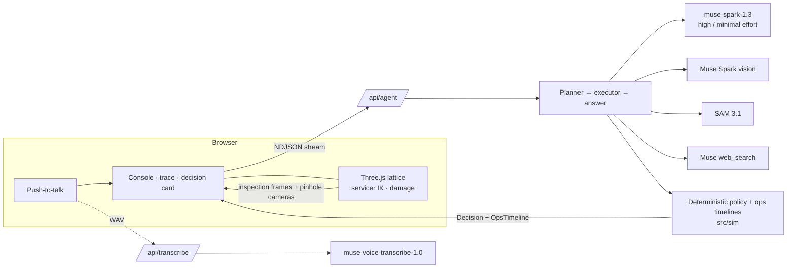

# LATTICE: self-servicing orbital compute, reasoning by Muse

> **GPUs age out in 3–5 years, and orbit doesn't let you upgrade them. Unless the station is modular.**

LATTICE is a modular orbital data center that maintains itself. Twelve self-sufficient compute modules dock to a ring
truss. A two-armed servicer robot and a depot of spare modules wait outside the keep-out sphere.

When a module fails, a ground agent built on **Meta's Muse models** takes it from detection to action:
1. **Diagnoses** the failure from telemetry and the module's **as-built record**.
2. **Looks** at the module through camera frames rendered live from the 3D scene (Muse Spark vision).
3. **Finds where to grab** with **SAM 3.1**. The segment boxes are unprojected into 3D and become the robot arm's grasp targets.
4. **Chooses** what to do:
   - **REPAIR**: swap a field-replaceable unit.
   - **SWAP**: undock the module and dock a newer-generation spare.
   - **DEORBIT**: send a dangerous module to a disposal orbit.

A **deterministic safety envelope** decides whether each action runs on its own, waits for a human, or is refused.
The language model never moves hardware.

**Live:** https://lattice-orbital.vercel.app · **Video:** _(link on the submission page)_ · Built for the Meta Global AI
Developer Hackathon, Startups track, *Push the Frontier*. [HACKATHON.md](HACKATHON.md) states exactly what was built during the event.

## Why modular: the station outlives its chips
A monolithic orbital data center is a single spacecraft:
- **One failure takes it down.** A single power, thermal or attitude-control fault takes the whole facility with it.
- **Its chips are frozen at launch.** By the time it pays back, it is a stranded asset.

LATTICE handles both cases:
- **Hardware refresh:** it swaps modules as their hardware ages.
- **Failures:** it repairs or replaces failed modules and deorbits dead ones.
- **Spares are next-generation:** every failure is also an upgrade.

The **Fleet** view in the app plays 2027 → 2037. LATTICE's capacity steps up generation by generation. A monolith of the same launch mass decays and is stranded. The numbers are illustrative.

The product rests on three pieces:

| Piece | In LATTICE |
|---|---|
| **The standard** | One module interface for power, thermal, data and the grapple point (`ICD-DOCK-01`, `ICD-GRP-01`) |
| **The servicer** | A two-armed free-flyer plus a spare-module depot, flying corridor-constrained proximity operations |
| **The brain** | Autonomous diagnosis from each module's as-built record: the build record as a virtual sensor |

## What Muse does
| Role | Meta model | What it does here |
|---|---|---|
| Planner + report | `muse-spark-1.3`, reasoning effort **high** | Writes a 4–7 step plan from the onboard event log; writes the operator report with every claim cited |
| Executor | `muse-spark-1.3`, effort **minimal** | Runs each step's tool calls quickly and cheaply. The trace shows the effort level of every call |
| Inspection | `muse-spark-1.3` vision | Reads servicer-camera frames **rendered from the live 3D scene** and assesses damage, citing `CAM-n` |
| Grasp targeting | **`sam-3.1`** | Segments the grapple fixture and radiator latch. Each box centre is unprojected through the camera model onto the module's geometry to give a 3D grasp point (`SEG-n`), checked against arm reach and the damage keep-out |
| Precedent | `muse-spark-1.3` + `web_search` | Finds public precedent (MEV, ISS radiator and ORU swaps), cited as `WEB-n` with URLs |
| Operator voice | `muse-voice-transcribe-1.0` | Push-to-talk questions and approvals. A spoken "approve" still needs an on-screen confirm |

Every answer is verified before it reaches the operator:
- Each citation id must exist in a tool result. Unknown ids are flagged.
- Every number in the answer must appear in tool output.
- The policy's checks are shown row by row.

## Scenarios
| Scenario | What the agent must work out | Outcome | Tier |
|---|---|---|---|
| **Micrometeoroid hit on M-09's radiator** | One coolant loop holds only ≤ 74 % util (TR-1180), so migrate first. SAM finds the grapple fixture; a grasp near the puncture is **refused** | REPAIR radiator B | **auto**: the hazard deadline comes before the next ground contact |
| **Primary bus short on M-04** | The catalogue says the PDU is field-replaceable. The **as-built record (NCR-0412) says it was potted during rework** | SWAP for spare S-1 (Gen-2: failure → upgrade) | **gated**: not time-critical; the operator approves by voice |
| **Stuck-open thruster on M-11** | Dock latch load reaches the 4,500 N limit (ICD-DOCK-01) about 13 min before anyone is reachable | DEORBIT | **auto**: a structural hazard with no human in time |

## Safety envelope (deterministic, `src/sim/policy.ts`)
The envelope runs these checks:
- `fru`: the unit is replaceable on *this* module, per its as-built record.
- `grasp`: the target is a SAM segment that lands on the module.
- `reach`: within 2.6 m of the arm shoulder.
- `damage-keepout`: at least 0.5 m from the damage.
- `drained`, `capacity`: workloads are migrated off first, and the lattice stays at or below 95 % load.
- `corridor-v`: closing rate at most 0.01·range + 0.02 m/s at each hold.
- `spare`: the spare is qualified.
- `debris`: the disposal corridor is clear.
- `deadline`: compared against the next ground contact.

The tiers are decided as follows:
- **Refused:** any safety check fails.
- **Auto:** the hazard deadline beats the next contact, or the action is reversible.
- **Gated:** everything else.

## Architecture


- **`src/sim`**: pure, deterministic TypeScript with no dependencies. It holds the lattice geometry, telemetry physics, as-built records, the policy, proximity-ops choreography (hold points, corridor), camera unprojection, and the fleet economics.
- **`src/scene`**: procedural react-three-fiber. It draws the lattice, the servicer with analytic two-arm IK, the damage effects and the cinematic cameras, and does the off-screen inspection capture.
- **`src/agent`, `src/meta`**: the agent loop, tools, citation and number checks, the Meta API clients, and the SAM token-stream parser and one-bit mask decoder.
- **`src/ui`, `src/components`**: the mission state machine and the console.

## Run it
```bash
npm install
cp .env.example .env.local      # add MODEL_API_KEY (Meta Model API)
npm run dev                     # http://localhost:3000
npm test                        # unit tests (sim, policy, SAM parser, agent loop with a fake model)
npm run eval                    # live: every scenario must reach its expected outcome and tier
```
The public site defaults to **Recorded run**, a replay of real Muse runs, so it costs nothing to watch. Switch to
**Live Muse** to run the agent yourself (rate-limited).

## Honest limits
- It is a simulator. Telemetry, records and orbital geometry are synthetic, and the fleet economics are illustrative.
- The model never commands hardware. It proposes; the deterministic policy decides and generates the motion plan.
- SAM runs on rendered frames rather than flight camera imagery. Grasp targets come from SAM's boxes and are unprojected onto known module geometry.
